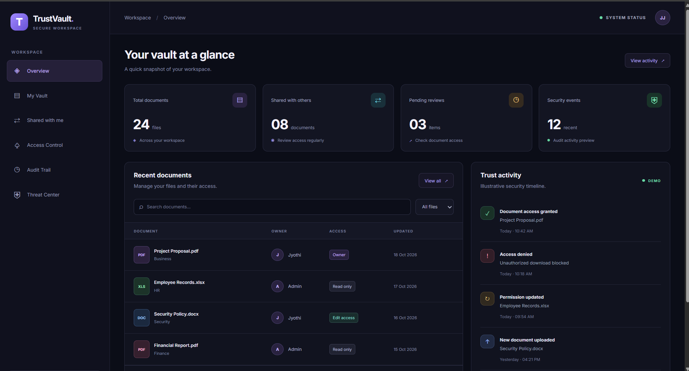
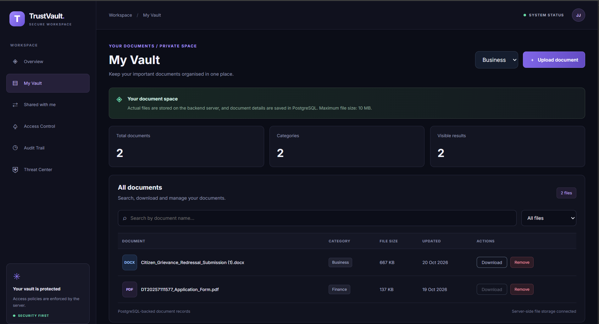
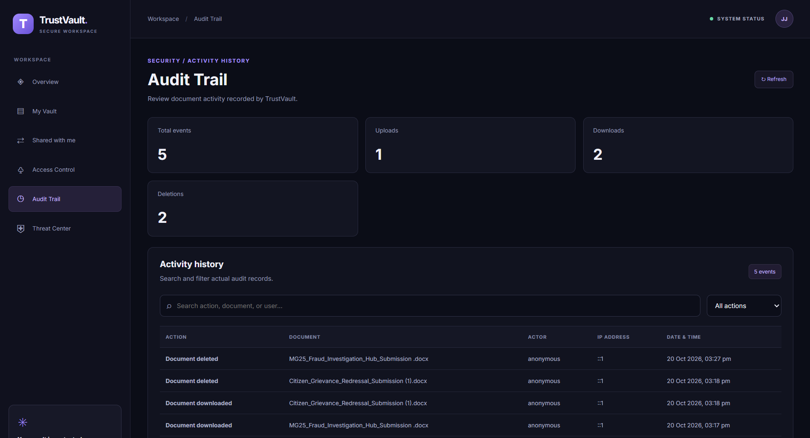

# TrustVault - Secure Document Management System

TrustVault is a web-based document management application built to upload, organize, download, and manage documents. It also maintains an audit trail of document activities.

## Live Demo

- **Frontend:** https://trust-vault-psi.vercel.app/
- **Backend:** https://trustvault-backend-z1yy.onrender.com

## Screenshots

### Overview



### My Vault



### Audit Trail



## Features

- Upload and manage documents
- Search documents and filter by category
- Download and delete documents
- Store document metadata in PostgreSQL
- Track document activities through audit logs
- View recent audit events, including upload, download, and delete actions

## Technologies Used

- **Frontend:** React, JavaScript, Vite
- **Backend:** Node.js, Express
- **Database:** PostgreSQL
- **Version Control:** Git and GitHub
- **Deployment:** Vercel (frontend), Render (backend)

## Project Structure

```text
TrustVault/
├── backend/
│   ├── db.js
│   ├── init-db.js
│   ├── server.js
│   └── package.json
├── frontend/
│   ├── public/
│   │   └── screenshots/
│   │       ├── overview.png
│   │       ├── my-vault.png
│   │       └── audit-trail.png
│   └── src/
└── README.md
```

## Run Locally

### Prerequisites

- Node.js and npm
- PostgreSQL

### 1. Clone the Repository

```bash
git clone https://github.com/jyothi017/TrustVault.git
cd TrustVault
```

### 2. Configure the Database

Create a PostgreSQL database and configure the required environment variables in `backend/.env`. Use `backend/.env.example` if it exists.

**Never commit your `.env` file or expose database credentials, passwords, or JWT secrets.**

### 3. Start the Backend

Open a terminal in the project folder:

```bash
cd backend
npm install
npm start
```

The backend runs locally at:

http://localhost:5000

### 4. Start the Frontend

Open a second terminal in the project folder:

```bash
cd frontend
npm install
npm run dev
```

Open the local frontend at:

http://localhost:5173

## Security

- Environment variables and dependency folders are excluded from version control using `.gitignore`.
- Database credentials and secrets should be stored in environment variables.
- Document operations and audit logging are supported by the application.

See [THREATS.md](THREATS.md) for documented security risks and mitigations, and [PROMPTS.md](PROMPTS.md) for AI-assisted development notes.

## Deployment

- **Live Application:** https://trust-vault-psi.vercel.app/
- **Backend Service:** https://trustvault-backend-z1yy.onrender.com
- **Source Code:** https://github.com/jyothi017/TrustVault

## Author

**Jetty Jyothi**

GitHub: https://github.com/jyothi017
